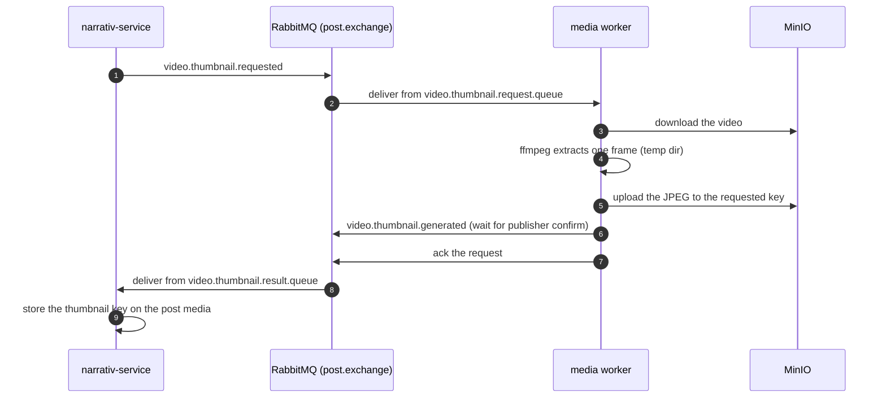

# narrativ-media-worker

A small Go service that generates video thumbnails for the NARRATIV backend (`narrativ-service`). It has no database
access: it talks only to RabbitMQ and MinIO, so it can be scaled, restarted or replaced without touching the API.

> The source is public for review only. It is not open source: see [LICENSE](LICENSE).

**Related repositories:** [narrativ-backend](https://github.com/rizkysiregar/narrativ-backend) (publishes the
requests and stores the results), [narrativ-android](https://github.com/rizkysiregar/narrativ-android) and
[narrativ-web-client](https://github.com/rizkysiregar/narrativ-web-client) (the clients that upload the videos).

## Tech stack

| Area      | Technology                                                                 |
| --------- | -------------------------------------------------------------------------- |
| Language  | Go 1.26, standard library (`log/slog` JSON logs, `net/http` probes)        |
| Messaging | RabbitMQ via `amqp091-go`, publisher confirms, manual acks, prefetch       |
| Storage   | MinIO (S3 compatible) via `minio-go`                                       |
| Media     | ffmpeg (static build) to extract one JPEG frame                            |
| Image     | Multi-stage Docker build on distroless `static-debian12:nonroot` (~57 MB)  |
| Delivery  | Jenkins (test, build, push to GHCR), Argo CD from a private GitOps repository |

## Architecture



1. `narrativ-service` saves the post with a null thumbnail and publishes a request.
2. The worker downloads the video, extracts one frame with ffmpeg and uploads it to the requested key.
3. The worker publishes the result (with publisher confirm), then acks the request.
4. `narrativ-service` stores the key on the post.

Exchange, queues and DLQs are declared by `narrativ-service` (`RabbitMQConfig`). The worker never
declares topology.

## Messages (JSON, `content_type: application/json`)

Request, published to `post.exchange` with routing key `video.thumbnail.requested`:

```json
{"postId": "uuid", "mediaId": "uuid", "mediaUrl": "user/POST_FEED/clip.mp4", "thumbnailObjectKey": "user/POST_FEED/clip_thumb.jpg"}
```

Result, published to `post.exchange` with routing key `video.thumbnail.generated`:

```json
{"postId": "uuid", "mediaId": "uuid", "thumbnailObjectKey": "user/POST_FEED/clip_thumb.jpg"}
```

Keep these in sync with `VideoThumbnailRequestedEvent` / `VideoThumbnailGeneratedEvent` in `narrativ-service`.

## Failure handling

- Transient errors are retried `WORKER_MAX_ATTEMPTS` times (1s, 2s, 4s... capped at 5s).
- Malformed or invalid messages are not retried.
- After the last attempt the request is rejected without requeue and lands in `video.thumbnail.request.dlq`.
- Delivery is at-least-once. A redelivery rewrites the same object, so no deduplication is needed.
- Videos shorter than 1s fall back to the first frame.

## Configuration

See `.env.example`. Required: `RABBITMQ_USERNAME`, `RABBITMQ_PASSWORD`, `MINIO_ENDPOINT`,
`MINIO_BUCKET`, `MINIO_ACCESS_KEY`, `MINIO_SECRET_KEY`.

Probes: `GET :8080/healthz` (liveness), `GET :8080/readyz` (ready once connected to RabbitMQ).

On `SIGTERM` the worker stops consuming and shuts the probe server down; a request it had not acked yet goes back to
the queue and is picked up again. A dropped broker connection is reconnected with backoff.

## Project structure

```
main.go                 wiring: config, storage, consumer, probes, graceful shutdown
internal/
  config/               settings from environment variables, with defaults for the optional ones
  storage/              Store interface and its MinIO implementation
  thumbnail/            Extractor interface and the ffmpeg implementation
  worker/               message types, Processor (download, extract, upload) and the RabbitMQ Consumer
```

`Processor` depends on the `Store` and `Extractor` interfaces, so the tests run it with fakes and need neither
RabbitMQ, MinIO nor ffmpeg.

## Develop

```
go vet ./... && go test ./...
docker build --platform linux/amd64 -t narrativ-media-worker .
```

The image is distroless plus a static ffmpeg binary (about 57 MB).

## Deployment

Every push to `main` runs the `Jenkinsfile`: checkout, `go test`, build and push
`ghcr.io/rizkysiregar/narrativ-media-worker:<sha>`, then a commit of the new tag to the private GitOps repository,
which Argo CD rolls out next to the backend.

## Security notes

- **No secrets in the repository.** RabbitMQ and MinIO credentials come from environment variables; `.env` is
  git-ignored and `.env.example` only lists the names. In Kubernetes they come from Secrets.
- **Least privilege.** The worker cannot reach the database, and it never declares RabbitMQ topology; it only reads
  one queue and publishes one routing key.
- **Hardened container.** Distroless base without a shell or package manager, running as a non-root user.
- **Bounded work.** Each attempt (download, ffmpeg, upload) has a timeout (`PROCESS_TIMEOUT_SECONDS`) and works in
  its own temporary directory, which is removed afterwards; the prefetch count (`WORKER_CONCURRENCY`) limits how many
  videos are processed at once.

## License

Copyright (c) 2026 Habib Rizky Almajid Siregar. All rights reserved. The code is public for review only; see
[LICENSE](LICENSE).
